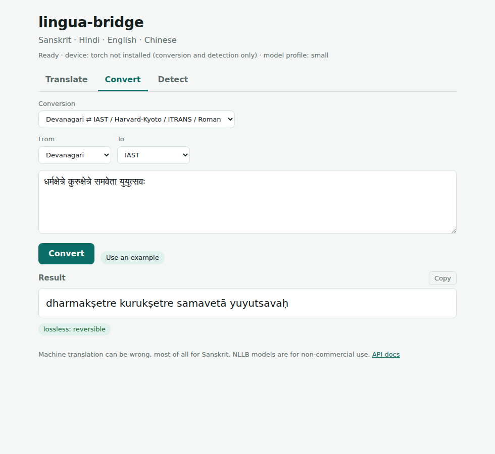
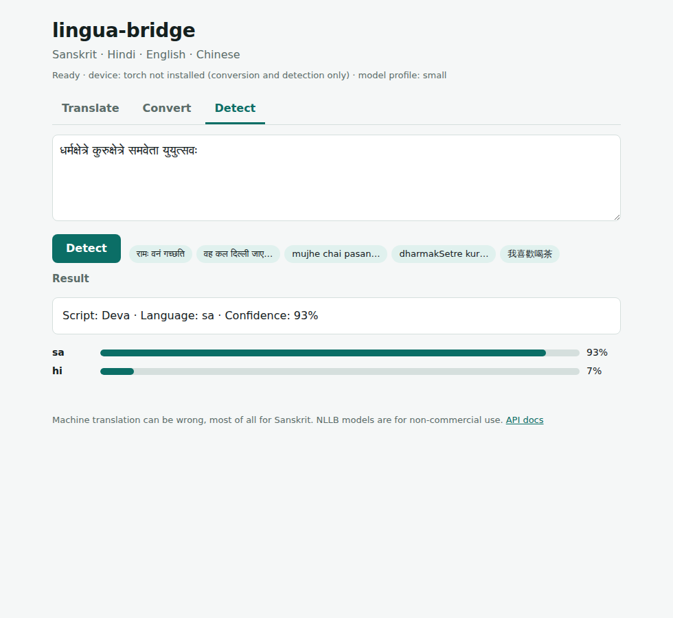

# lingua-bridge

Translation, transliteration and script conversion for **Sanskrit, Hindi, English and Chinese**, with automatic language and script detection. One library, exposed as a command line, a web service, and a small web page.

* **Translation** between any pair of the four languages (12 directions). Every translation reports which models handled it, and whether it had to pivot through English.
* **Conversion** (no translation involved): Devanagari ⇄ IAST / Harvard-Kyoto / ITRANS / casual Roman, Hinglish (Roman Hindi) → Devanagari, Chinese → pinyin, Simplified ⇄ Traditional.
* **Detection** of script and language, honest about Hindi versus Sanskrit being hard to tell apart.

| Convert and detect work out of the box | Translation downloads models on first use |
|---|---|
|  | See [First translation](#first-translation) below |



## Run it

You need **Python 3.11 or newer** ([python.org/downloads](https://www.python.org/downloads/); on Windows tick "Add python.exe to PATH") and an internet connection for the first run. Nothing else.

| System | Command |
|---|---|
| Windows | double-click `run.bat` (or run it in a terminal) |
| Linux / macOS | `./run.sh` |

The script creates a private environment in `.venv`, installs everything, runs a health check (`lingua doctor`), starts the server and opens the web page at <http://localhost:8000>. The first run installs PyTorch (a few GB) and takes a while. Later runs start in seconds.

* **Only want conversion and detection?** `run.bat --light` or `./run.sh --light`: installs in seconds, no PyTorch.
* **Docker:** see [Docker](#docker).

### First translation

The first translation downloads the models from Hugging Face into your user cache folder (set `HF_HOME` to move it). Measured download sizes for the default `small` profile:

| Model | Used for | Size |
|---|---|---|
| `ai4bharat/indictrans2-en-indic-dist-200M` | English to Hindi/Sanskrit | 1.1 GB |
| `ai4bharat/indictrans2-indic-en-dist-200M` | Hindi/Sanskrit to English | 0.9 GB |
| `ai4bharat/indictrans2-indic-indic-dist-320M` | Sanskrit ⇄ Hindi | 1.3 GB |
| `facebook/nllb-200-distilled-600M` | everything involving Chinese | 2.5 GB |

About 5.8 GB in total; the first sentence you translate can take several minutes. Run `lingua download-models` to fetch them up front with progress bars. The `base` profile (`LB_PROFILE=base`, 1B-parameter models, roughly 19 GB) needs 8 GB or more of GPU memory; the `small` profile fits a 4 GB GPU.

### One optional, one-time step for best Sanskrit quality

The IndicTrans2 models are **gated** on Hugging Face: you have to accept their terms once. Without this step everything still works, because translation falls back to NLLB and tells you so in the output, but Sanskrit and Hindi quality is lower.

1. Create a free account at <https://huggingface.co>.
2. While logged in, open each page and click **Agree and access repository**:
   [en-indic-dist-200M](https://huggingface.co/ai4bharat/indictrans2-en-indic-dist-200M),
   [indic-en-dist-200M](https://huggingface.co/ai4bharat/indictrans2-indic-en-dist-200M),
   [indic-indic-dist-320M](https://huggingface.co/ai4bharat/indictrans2-indic-indic-dist-320M).
3. Create a **read** token at <https://huggingface.co/settings/tokens>, then run `lingua login` and paste it (or put `HF_TOKEN=...` in `.env`).
4. `lingua doctor` should now show "IndicTrans2 access: ok".

### GPU

If an NVIDIA GPU is present but PyTorch cannot use it (the usual situation on Windows, where pip installs a CPU-only build), `run.bat` tries the official CUDA builds in turn. `lingua doctor` tells you which situation you are in and what to do. Without a GPU, translation runs on the CPU, only slower.

## Use it

### Web page

`lingua serve --open` (the run scripts do this). Three tabs: Translate, Convert, Detect. After a translation the page shows the route, for example "pivot through English: errors can compound", the model used for each step, and any warnings.

### Command line

```bash
lingua translate "धर्मक्षेत्रे कुरुक्षेत्रे समवेता युयुत्सवः" --src sa --tgt en
lingua translate "I like tea." --tgt zh --zh traditional
lingua translate "मुझे चाय पसंद है।" --tgt sa          # source auto-detected
lingua detect "रामः वनं गच्छति"
lingua convert translit "संस्कृतम्" --from devanagari --to iast       # saṃskṛtam
lingua convert translit "rAmaH" --from hk --to devanagari             # रामः
lingua convert hinglish "mera naam Vinay hai"                         # मेरा नाम विनय है
lingua convert pinyin "你好，世界" --style marks                       # nǐ hǎo, shì jiè
lingua convert script "我喜欢喝茶" --to traditional                    # 我喜歡喝茶
lingua doctor              # checks your machine and says what to fix
lingua download-models     # fetch models now
```

Add `--json` for machine-readable output. `translate` prints the route it used on stderr.

### HTTP API

Interactive docs at <http://localhost:8000/docs>.

```bash
curl -s localhost:8000/translate -H 'content-type: application/json' \
  -d '{"text": "रामः वनं गच्छति", "src": "sa", "tgt": "zh"}'
curl -s localhost:8000/convert -H 'content-type: application/json' \
  -d '{"text": "संस्कृतम्", "op": "transliterate", "source_scheme": "devanagari", "target_scheme": "iast"}'
curl -s localhost:8000/detect -H 'content-type: application/json' -d '{"text": "मुझे चाय पसंद है"}'
```

Also `GET /healthz`, `/languages`, `/models`. Errors are JSON: `{"error": "unknown_language", "message": "..."}` with status 422, 413 (too long) or 503 (model unavailable, with what to do about it).

### Python library

```python
from lingua_bridge import LinguaBridge, detect

print(detect("रामः वनं गच्छति").language)          # 'sa'
bridge = LinguaBridge()
result = bridge.translate("रामः वनं गच्छति", src="sa", tgt="zh")
print(result.text, result.via, [(h.src, h.tgt, h.model) for h in result.route])
```

## How translation is routed

| Pair | Default route |
|---|---|
| Sanskrit, Hindi, English among themselves (6 pairs) | direct, IndicTrans2 |
| English ⇄ Chinese, Hindi ⇄ Chinese | direct, NLLB-200 |
| Sanskrit ⇄ Chinese | **pivot through English**: IndicTrans2 for the Sanskrit step, NLLB for the Chinese step |

Why Sanskrit ⇄ Chinese pivots: it is a hypothesis, not a measured result. NLLB's Sanskrit data is thin, so the specialist handles the Sanskrit step. Change any pair with `LB_ROUTE_OVERRIDES` (see `.env.example`) and let `python eval/run_eval.py --compare` pick with real scores. Every route is logged by the `lingua_bridge.route` logger and returned in the API response.

Chinese output is Simplified unless you ask for Traditional (`--zh traditional`, or `"zh_variant": "traditional"`); Traditional input is converted to Simplified before translation. Sanskrit typed in IAST, Harvard-Kyoto or ITRANS is converted to Devanagari before translation, and romanized Hindi goes through the Hinglish engine.

## Models and licenses (checked against the model cards)

| Model | Covers | License | Note |
|---|---|---|---|
| IndicTrans2 (AI4Bharat) | English + 22 Indic languages incl. `san_Deva`, `hin_Deva`. **No Chinese.** | MIT | gated: accept terms once |
| NLLB-200 (Meta) | 200 languages incl. `san_Deva`, `hin_Deva`, `eng_Latn`, `zho_Hans`, `zho_Hant` | **CC-BY-NC 4.0, non-commercial** | model card: a research model, not for production, trained on inputs up to 512 tokens |
| Helsinki opus-mt (optional) | English ⇄ Chinese only | CC-BY-4.0 (zh-en), Apache-2.0 (en-zh) | opt-in per pair |

**NLLB's non-commercial license applies to anything you build with it that uses NLLB.** See `NOTICE.md`. The code in this repository is MIT-licensed.

## Conversion: what "lossless" means

| Conversion | Reversible? |
|---|---|
| Devanagari ⇄ IAST ⇄ Harvard-Kyoto ⇄ ITRANS | Yes for well-formed text (tested). Not for ill-formed input or hiatus sequences such as `कइ`. |
| Devanagari → casual Roman | No (long vowels and retroflex letters collapse) |
| Hinglish → Devanagari | No: Roman Hindi spelling is not standardized, the output is a prediction |
| Chinese → pinyin | No (homophones, context-dependent readings, optional tones) |
| Simplified ⇄ Traditional | Not exactly (several traditional characters merged when simplified) |

The web page and API label each result as `lossless`, `lossy` or `best effort`.

## Configuration

Everything is an environment variable (prefix `LB_`) or a line in `.env`, which the run scripts create from `.env.example`. The file documents every setting. The common ones: `LB_PROFILE` (`small` or `base`), `LB_DEVICE` (`auto`, `cuda`, `cpu`), `LB_TRANSLATION_ENGINE` (`auto` or `nllb`), `LB_ROUTE_OVERRIDES`, `LB_MAX_LOADED_MODELS` (lower it if your GPU runs out of memory), `HF_TOKEN`.

## Development

```bash
python -m venv .venv && . .venv/bin/activate        # Windows: .venv\Scripts\activate
pip install -e ".[dev,api,translate,eval]"
pytest                    # 192 tests, no model downloads
ruff check . && ruff format --check .
LB_RUN_SLOW=1 pytest -m slow     # real models; downloads GBs, IndicTrans2 tests need the HF login
```

Architecture and design decisions: [`docs/ARCHITECTURE.md`](docs/ARCHITECTURE.md).

### Evaluation

```bash
python eval/fetch_data.py                 # FLORES-200, ~25 MB
python eval/run_eval.py --limit 100       # quick check of all 12 pairs
python eval/run_eval.py --compare         # also try alternative models/routes per pair
```

Writes `eval/results.md` with chrF++ and BLEU per pair, the sacrebleu signatures, and the `LB_ROUTE_OVERRIDES` of any variant that beat the default. **`eval/results.md` currently contains no scores: the evaluation has not been run**, so this README has no results table. Run it to get yours.

## Docker

```bash
docker build -t lingua-bridge .                         # CPU image
docker run -p 8000:8000 -v lingua_models:/models lingua-bridge
# GPU: build with --build-arg TORCH_INDEX=https://download.pytorch.org/whl/cu126, run with --gpus all
```

Model weights are never baked into the image; they download into the `/models` volume on first use. Pass `-e HF_TOKEN=...` for IndicTrans2. CI (`.github/workflows/ci.yml`) lints, tests on Python 3.11 and 3.12, builds the image and pushes it to GHCR from `main`.

## What has and has not been tested

Tested in the development environment (Linux, Python 3.11, and a clean-copy install on Python 3.13):

* 192 automated tests pass: conversion round-trips, detection, routing (including pivots and the gated-model fallback), engine, API, CLI, evaluation tooling, the IndicTrans2 text-processor port against golden outputs from the compiled original, and the NLLB backend plumbing against a tiny locally built model.
* The web page was driven in a real browser (all tabs, error states, phone width, light and dark themes).
* `run.sh --light` was run from a fresh copy of the project: it installed and served the app.
* Model cards and download sizes were read directly from Hugging Face.

**Not tested here, because it needs things this environment cannot provide:**

* Translation with the real downloaded weights (the weight CDN is not reachable from the development environment, and the IndicTrans2 repos are gated). The backends follow the model cards' usage, and `safe_generate` guards two known failure modes, but no real translation output has been checked.
* `run.bat` on Windows, and the automatic CUDA-build selection on a machine with an NVIDIA GPU.
* The Dockerfile (the sandbox could not pull the base image) and the GitHub Actions workflow.
* The optional neural Hinglish engine (`pip install -e ".[xlit]"`); its dependency `fairseq` often fails to install on modern Python, so the rule-based engine is the default.
* The evaluation scripts against real FLORES data and real models (their logic is unit-tested with synthetic data).

## Limitations

* **Sanskrit quality.** Sanskrit is the lowest-resource language here. Expect uneven or wrong translations, especially for verse, compounds, sandhi and Vedic text. Do not rely on it for anything that matters without a reader who knows Sanskrit.
* **Pivot error compounding.** Sanskrit ⇄ Chinese goes through English by default: the second model translates text that already contains the first model's mistakes. Compare with a direct route using the evaluation script.
* **Domain mismatch.** The models are trained on general-domain text. Medical, legal, technical, conversational and poetic text will translate worse, and NLLB's model card says it is not intended for document translation. Long text is split into sentences and translated independently, so cross-sentence context (pronouns, references) is lost.
* **Hindi versus Sanskrit detection is a heuristic.** It uses word lists and morphology, not a trained model. Short texts are genuinely ambiguous; the result then says so and `--src` should be given explicitly.
* **Hinglish conversion is approximate.** The rule-based engine knows a few hundred common words plus spelling rules. Unusual words, names and slang may come out wrong.
* **Pinyin and Traditional conversion are lossy** by nature (see the table above).
* **Non-commercial.** NLLB-200 weights are CC-BY-NC 4.0.
* **One request at a time per model.** A lock serializes generation, so concurrent users queue.
* **Not a certified translator.** Machine translation can be fluent and wrong.

## License

MIT for the code in this repository (see `LICENSE`; the copyright line says "lingua-bridge authors", so put your own name there). Model weights keep their own licenses; see `NOTICE.md`.
